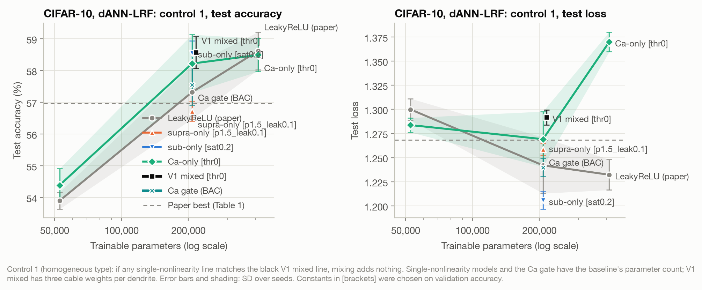
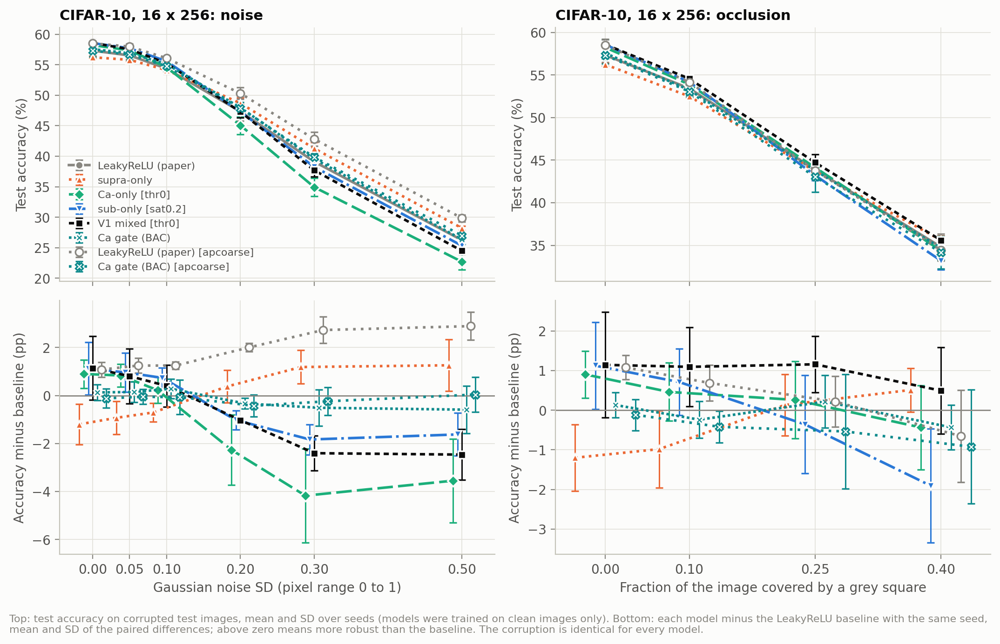
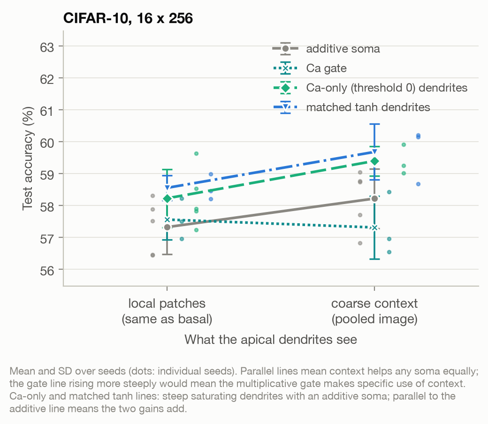
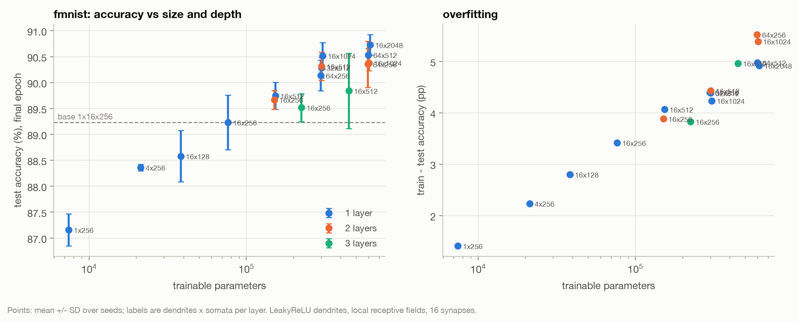
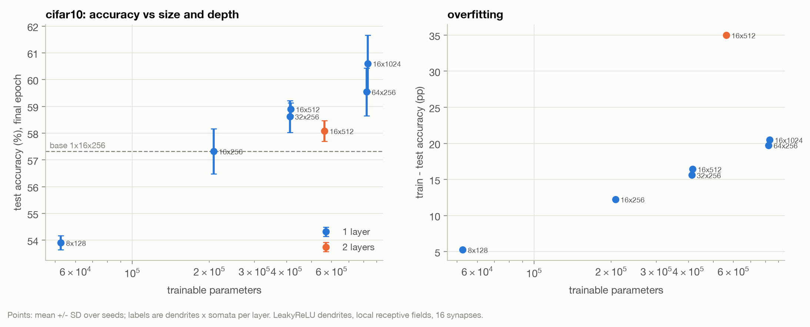

# Dendritic ANNs: Project Synthesis

November 27, 2026

## Summary

Making the dendrites more biological helped only small models, by about one point; making the model wider helped every time, by up to 3.2 points on CIFAR-10.

We replicated the dendritic ANN (dANN) of Chavlis & Poirazi (2025) and then asked whether more realistic dendritic nonlinearities improve it. With default constants they did not. After tuning, a steep saturating dendrite (Ca spike at threshold 0, or a matched tanh) gained about one point at the paper's size, but the gain is not specific to calcium spikes and it costs robustness to pixel noise. Feeding the apical dendrites a coarse, wide-field copy of the image added another point, and the two gains stacked. Finally, scaling the plain model up beat everything: four times the somata reached 60.60% on CIFAR-10 and 90.52% on Fashion-MNIST, and at that width the biological dendrites no longer beat LeakyReLU.

| Milestone | CIFAR-10 test accuracy (%) | Params |
| --- | --- | --- |
| Paper's model, replicated (1 x 16 x 256, LeakyReLU) | 57.32 +/- 0.85 | 208k |
| Steep saturating dendrite (Ca-only, threshold 0) | 58.22 +/- 0.91 | 208k |
| Matched tanh + coarse apical input | 59.68 +/- 0.87 | 208k |
| Wider: 1 x 16 x 1024, LeakyReLU | 60.60 +/- 1.06 | 830k |

Architectures are written layers x dendrites per soma x somata. Accuracies are means +/- SD over 3 to 5 seeds; differences quoted later are paired by seed (same data split and wiring).

## 1. Where we started: replicating the paper

Our PyTorch re-implementation matches the paper on both datasets, so every later comparison starts from a faithful baseline.

The dANN routes each pixel patch to a dendrite, passes it through a LeakyReLU, and sums a soma's 16 dendrites through a masked cable layer. We used the local-receptive-field version (dANN-LRF), 16 synapses per dendrite, Adam at learning rate 0.001, 25 epochs on Fashion-MNIST and 50 on CIFAR-10, with 10% of the training set held out for validation.

| Dataset | Best size | Ours (%) | Paper, Table 1 (%) |
| --- | --- | --- | --- |
| Fashion-MNIST | 64 x 256 | 90.14 +/- 0.29 (5 seeds) | 90.26 +/- 0.22 |
| CIFAR-10 | 16 x 256 | 57.32 +/- 0.85 (5 seeds) | 56.97 +/- 0.98 |

We fixed 1 x 16 x 256 as the reference model for everything that follows: 89.23% on Fashion-MNIST and 57.32% on CIFAR-10.

## 2. Adding biological dendrites

With their first-guess constants, none of the biological dendrites beat LeakyReLU, and on CIFAR-10 most lost 1 to 2 points.

We replaced the LeakyReLU with three nonlinearities seen in cortical pyramidal cells. Supralinear (NMDA-like) is relu(u)^p. Sublinear is s tanh(u/s). The calcium spike is A sigmoid(k(u - theta)). Three designs tested how to combine them, all at 1 x 16 x 256:

- **V1 mixed:** every dendrite computes all three, and the soma learns a weight for each.
- **Single type (control 1):** every dendrite uses one nonlinearity, with the baseline's parameter count.
- **Per-dendrite ratio:** each dendrite gets one type, mixed within a soma at 12:3:1 (biological: mostly NMDA branches, one apical Ca site), 1:1:1 or 1:3:12.

| Dendrite (default constants) | Fashion-MNIST (%) | CIFAR-10 (%) |
| --- | --- | --- |
| LeakyReLU (paper) | 89.23 +/- 0.53 | 57.32 +/- 0.85 |
| V1 mixed | 89.07 +/- 0.72 | 57.40 +/- 0.72 |
| Supra-only | 88.96 +/- 0.39 | 56.23 +/- 0.17 |
| Sub-only | 88.63 +/- 0.92 | 55.89 +/- 0.83 |
| Ca-only | 88.99 +/- 0.60 | 55.50 +/- 0.23 |
| Ratio 12:3:1 (biological) | 89.10 +/- 0.54 | 56.11 +/- 0.99 |
| Ratio 1:3:12 (Ca-heavy) | 89.37 +/- 0.24 | 56.02 +/- 0.86 |

Mixing types gave nothing that the best single type did not, and the biological 12:3:1 ratio was never the best mix. The fixed functions clip: Ca is flat away from threshold, tanh saturates and relu^p is zero for negative input. That pointed to the constants.

## 3. Tuning the constants

Lowering the Ca threshold from 1.0 to 0 turned the worst dendrite into the best: Ca-only rose from 55.50% to 58.22% on CIFAR-10, +0.90 +/- 0.59 over LeakyReLU (4 of 5 seeds, p = 0.03).

The default threshold was the problem. At 1.0, 42% of Ca dendrites never switched on for any Fashion-MNIST image; at 0, only 8% stayed silent. We ran a grid over every constant (threshold, gain, exponent, saturation, and a passive leak f(u) + 0.1u) with one seed, picked the winners on validation accuracy, never test, and reran them with 3 to 5 seeds.

| Tuned dendrite, 1 x 16 x 256 | Fashion-MNIST (%) | CIFAR-10 (%) | CIFAR-10 vs LeakyReLU (paired) |
| --- | --- | --- | --- |
| LeakyReLU (paper) | 89.13 +/- 0.70 | 57.32 +/- 0.85 | |
| Ca-only, threshold 0 | 89.70 (+0.57, 3 of 3, p = 0.01) | 58.22 +/- 0.91 | +0.90 +/- 0.59 (4 of 5) |
| Sub-only, saturation 0.2 | 89.61 | 58.55 +/- 0.39 | +1.12 +/- 1.09 (2 of 3) |
| V1 mixed, threshold 0 | 89.24 | 58.57 +/- 0.50 | +1.14 +/- 1.33 (3 of 3) |
| Supra-only, p 1.5, leak 0.1 | | 56.72 +/- 0.31 | -0.71 +/- 1.12 |

Trained Ca dendrites act as selective switches: on CIFAR-10, 78% of their outputs sit near 0 or 1 and 85% of dendrites turn on for some images and off for others.

## 4. Is the gain real?

The gain is real at the paper's size, but it belongs to steep bounded dendrites in general, not to calcium spikes, and it fades as the model grows.

- **Not Ca-specific.** At threshold 0 the Ca function is sigmoid(10u), which equals 0.2 tanh(5u) up to a shift and scale the soma absorbs. That matched tanh ties Ca-only (-0.13 pp on the same seeds).
- **Steepness matters.** Changing the Ca gain from 10 to 1, 3 or 30 gives 55.05, 57.03 and 54.58% on CIFAR-10; gain 10 is the sweet spot.
- **Size-dependent.** The paired gain is +0.49 at 8 x 128, +0.90 at 16 x 256 and -0.13 at 32 x 256, where Ca-only overfits (83% train accuracy against 74%).
- **Survives regularisation.** With weight decay 1e-4 the gain is +1.31 (3 of 3 seeds); with 1e-3 it is +2.95 (3 of 3), though decay lowers both models.
- **The Ca gate does nothing.** A model where an apical Ca plateau multiplies the basal drive scores 57.56% (+0.13). Its gate values are bimodal and nearly unrelated to basal drive (r = -0.19), so it acts as a gain switch, not a coincidence detector.

## 5. Beyond clean accuracy

The dendrite type matters more for robustness than for clean accuracy, and the two pull in opposite directions: steep saturating dendrites lose under pixel noise, supralinear ones gain.

We tested every trained model, without retraining, on images with Gaussian pixel noise or a grey square covering part of the image. The table gives each model minus LeakyReLU on the same seeds, in percentage points.

| Model | FMNIST noise SD 0.3 | FMNIST 40% occluded | CIFAR-10 noise SD 0.3 | CIFAR-10 40% occluded |
| --- | --- | --- | --- | --- |
| Supra-only | +10.9 | +1.0 | +1.2 | +0.5 |
| Ca-only, threshold 0 | -5.9 | +4.1 | -4.2 | -0.4 |
| Matched tanh | -3.5 | +4.4 | -1.8 | -1.9 |
| Ca gate | -3.4 | -1.5 | -0.5 | -0.4 |

On CIFAR-10, Ca-only's one-point gain on clean images becomes a loss once noise reaches SD 0.2. Supralinear dendrites beat the baseline under strong noise in 3 of 3 seeds on both datasets.

**Data efficiency.** Trained on 1,000, 5,000 or 20,000 images, the steep dendrites keep roughly their full-data edge (CIFAR-10 matched tanh: +0.93, +0.58, +0.89) and it does not grow as data shrinks.

## 6. Apical context and stacking

Giving apical dendrites a coarse, wide-field view of the image added about one point on CIFAR-10 at no parameter cost, and it stacked with the steep dendrite to reach 59.68%.

In cortex the apical tuft receives contextual input rather than the same local patch as the basal dendrites. With coarse apical input, each soma's 4 apical dendrites (of 16) read a 4x average-pooled copy of the image; pooling has no parameters. On CIFAR-10 this gave +0.90 +/- 0.37 (5 of 5 seeds, p = 0.006), and the margin grew under noise to +2.7 at SD 0.3. It helped the additive soma only: the multiplicative Ca gate got nothing from context (-0.25).

| CIFAR-10, 1 x 16 x 256 | Local apical input (%) | Coarse apical input (%) | Both changes vs paper (paired) |
| --- | --- | --- | --- |
| LeakyReLU (paper) | 57.32 | 58.22 | +0.90 +/- 0.37 (5 of 5) |
| Ca-only, threshold 0 | 58.22 | 59.39 | +1.97 +/- 0.89 (3 of 3) |
| Matched tanh | 58.55 | 59.68 | +2.25 +/- 0.37 (3 of 3, p = 0.009) |

The interaction between dendrite type and context is near zero (-0.37 and +0.05), so each change adds its own point. Coarse context also cancels the noise fragility of steep dendrites: matched tanh with context is 1.7 to 2.5 points above the baseline at every noise level.

## 7. Scaling the architecture: width beats depth

Widening the plain LeakyReLU model beat every biological change: four times the somata gave +3.18 points on CIFAR-10 and +1.39 on Fashion-MNIST, while extra layers helped little or hurt.

We swept 14 architectures on Fashion-MNIST (locally) and 5 on CIFAR-10 (Colab), varying somata per layer, dendrites per soma and layers, 3 seeds each.

| Architecture | Fashion-MNIST (%) | vs base | CIFAR-10 (%) | vs base |
| --- | --- | --- | --- | --- |
| 1 x 16 x 1024 | 90.52 +/- 0.26 | +1.39 (3 of 3) | 60.60 +/- 1.06 | +3.18 (3 of 3) |
| 1 x 64 x 256 | 90.14 +/- 0.29 | +0.91 (5 of 5) | 59.54 +/- 0.89 | +2.11 (3 of 3) |
| 1 x 16 x 512 | 89.74 +/- 0.26 | +0.51 (5 of 5) | 58.90 +/- 0.24 | +1.47 (3 of 3) |
| 2 x 16 x 512 | 90.31 +/- 0.28 | +1.18 (3 of 3) | 58.08 +/- 0.39 | +0.65 (2 of 3) |
| 1 x 16 x 256 (base) | 89.23 +/- 0.53 | | 57.32 +/- 0.85 | |

- **Fashion-MNIST levels off** at about 300k parameters; doubling to 600k (1 x 16 x 2048: 90.73%) adds at most 0.2 points.
- **CIFAR-10 has not levelled off.** 1 x 16 x 1024 is the best CIFAR-10 model in the project, ahead of the stacked model's 59.68%, though with four times the parameters.
- **Depth does not pay.** At equal parameters one layer matches or beats two, three layers are worse, and the 2-layer CIFAR-10 model overfits by 35 points (train minus test).
- **Overfitting grows with width:** the train-test gap rises from 12 to 20 points on CIFAR-10.

## 8. Dendrite types on the wide model

On 1 x 16 x 1024 the steep-dendrite gain disappears on both datasets, and on CIFAR-10 every biological dendrite ends up below LeakyReLU.

We retrained the tuned Ca, matched tanh and supra dendrites on 1 x 16 x 1024. Differences from LeakyReLU are paired by seed; the CIFAR-10 column also gives the test accuracy at each run's best-validation epoch (early stopping).

| Dendrite on 1 x 16 x 1024 | Fashion-MNIST vs LeakyReLU | CIFAR-10 vs LeakyReLU, final epoch | CIFAR-10, early-stopped |
| --- | --- | --- | --- |
| Ca-only, threshold 0 | +0.08 +/- 0.28 (2 of 3) | -1.81 +/- 0.25 (0 of 3, p = 0.006) | +0.05 |
| Matched tanh | +0.09 +/- 0.19 (2 of 3) | -0.36 +/- 0.12 (0 of 3) | +0.86 |
| Supra, p 1.5, leak 0.1 | -0.53 +/- 0.33 (0 of 3) | -1.70 +/- 1.06 (0 of 3) | -0.95 |

At the paper's size the same Ca and tanh dendrites gained about +0.5 on Fashion-MNIST and +0.9 to +1.1 on CIFAR-10. On the wide model they fit the training set harder (CIFAR-10 train accuracy 89.7% and 85.4% against 81.1%) and overfit, so the final-epoch result drops; with early stopping there is no reliable gain either. Steep dendrites seem to help a small network use limited capacity, and a wider network does not need that help.

## 9. Conclusions and caveats

In this dANN, how the network is wired and how big it is matter more than which biological nonlinearity its dendrites use.

1. **Dendrite type is a small-model effect.** A steep bounded dendrite adds about one point at 1 x 16 x 256, whether it is a Ca spike or a tanh, and nothing once the model is wide.
2. **Robustness is where the type shows.** Steep dendrites are fragile to pixel noise; supralinear dendrites are the most noise-tolerant.
3. **Wiring helps cheaply.** Coarse apical context adds a point and noise tolerance at zero parameter cost, and stacks with the dendrite gain.
4. **Width is the biggest lever.** Four times the somata gives +3.2 points on CIFAR-10; depth does not help.

**Caveats.** Most comparisons use 3 seeds, and p-values are not corrected for the number of models compared. The biological variants were tuned while the baseline was tuned only for weight decay. The stacked model has only been tested at 1 x 16 x 256.

**Next.** Test coarse apical input on the wide model, to see whether the wiring gain survives where the dendrite gain did not. Add regularisation or early stopping to the wide CIFAR-10 models, which overfit by 20 points.
